# fiber_speckle_thermo

中文 | [English](README_en.md)

基于 FPGA 的多模光纤沿线温升实时报警终端。

一根多模光纤绕在液冷管路上，相机采集光纤出射的散斑，EdgeBoard FZ3B 在板上完成采集、QCNN 推理、报警判断、屏幕显示和 MQTT 上报。

| 项目 | 内容 |
|---|---|
| 赛道 | 2026 全国大学生嵌入式芯片与系统设计竞赛 · FPGA 赛道 · AMD 自主选题（初级组） |
| 板卡 | EdgeBoard FZ3B，Zynq UltraScale+ ZU3EG（`xczu3eg-sfvc784-1-i`） |
| 相机 | OV9281，MIPI CSI-2 1-lane，RAW8 640×800 |
| 工具 | Vivado 2026.1；板上 Linux 4.14、Python 3.6.9、numpy 1.13.3 |
| 协议 | MIT |

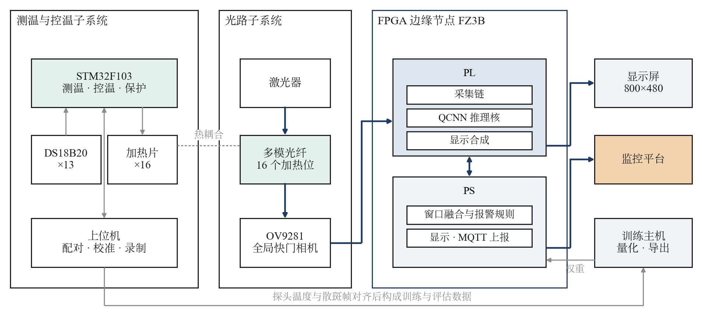

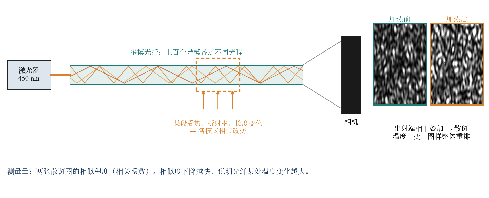

光纤某一段受热时，折射率和光纤长度都会变化，各模式的光程随之改变，散斑图样整体重排。比较前后两张散斑图的相似程度，就能知道光纤沿线有没有地方在升温。

## 成果

### 难点：不加热时散斑也在漂移

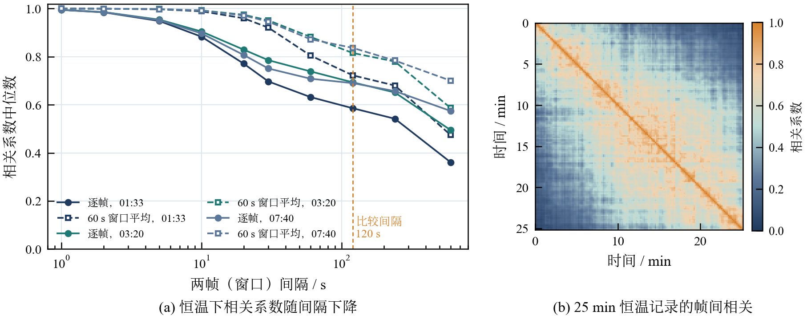

加热全关时，相隔 60 s 的两帧相关系数已降到 0.6～0.7，而探头温度几乎不变，这是激光器波长与功率起伏造成的。把 60 s 的帧平均后再比较，相关系数明显回升，报警方法即建立在这一规律上，门限用不加热对照数据标定。

### 报警效果：与其他方法同协议对比

第三次采集 11 段数据，5 折留出，门限只用训练折的不加热对照数据确定。检出率在 1% 误报下统计，针对 2 min 内单路升温 ≥1 °C 的窗口。

| 方法 | AUC | 检出率 | 事件检出 | 延迟中位 | 计算量 (MMAC) | 能否在 PL 上实时运行 |
|---|---|---|---|---|---|---|
| **本设计**（QCNN + 窗口去相关） | **0.993** | **92%** | **30/30** | **25 s** | **2.6** | **能** |
| ResNet-18 微调 | 0.994 | 95% | 30/30 | 63 s | 712 | 否 |
| MobileNetV3-S 微调 | 0.992 | 94% | 30/30 | 33 s | 22 | 否 |
| 窗口均方差 | 0.986 | 86% | 30/30 | 25 s | — | — |
| 逐帧相关 | 0.816 | 30% | 24/30 | 213 s | — | — |
| ResNet-18 特征距离 | 0.817 | 15% | 25/30 | 125 s | 3628 | 否 |
| ViT-B/16 特征距离 | 0.777 | 9% | 14/30 | 205 s | 35126 | 否 |

检出率与微调后的大模型相当；报警延迟是 ResNet-18 的 2/5，计算量是 ResNet-18 的 1/270、MobileNetV3-S 的 1/8，且只有本设计能在 PL 上实时运行。

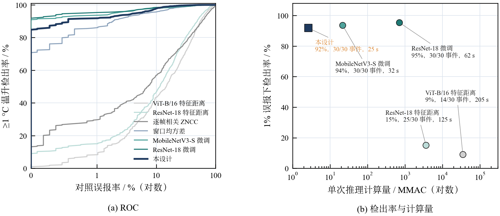

### 一段 80 min 长平台的报警过程（留出数据）

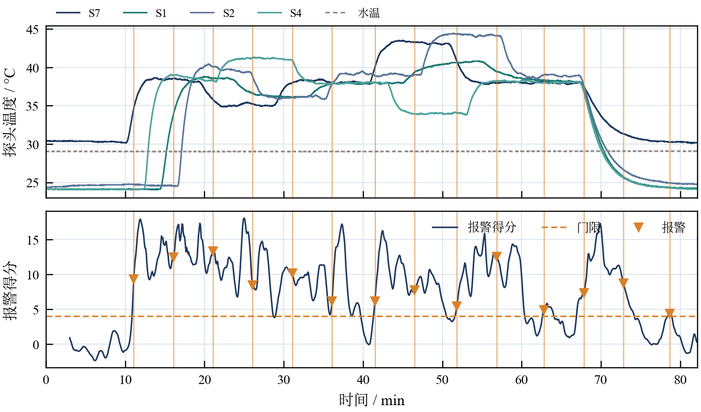

上图为加热各路的探头温度，下图为报警得分。每次设定上调后，得分在半分钟左右越过门限并报警；温度保持不变后，得分回落到门限以下。

| 检出率随温升幅度 | 报警延迟 |
|---|---|
| 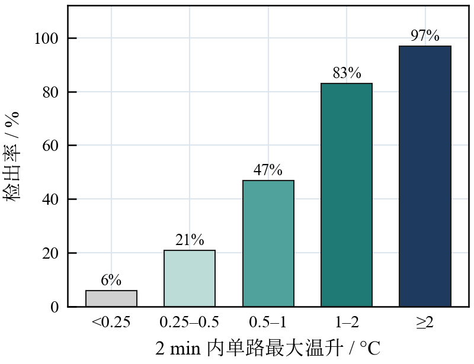 | 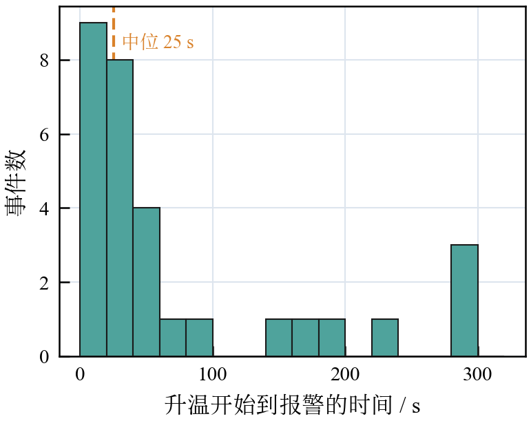 |

两路得分的分布：横轴为窗口去相关 1 − r，纵轴为 QCNN 温升估计，空心点为不加热对照，彩色点为加热段（颜色为 2 min 内单路温升）。对照点集中在左下角，温升越大越往右上：

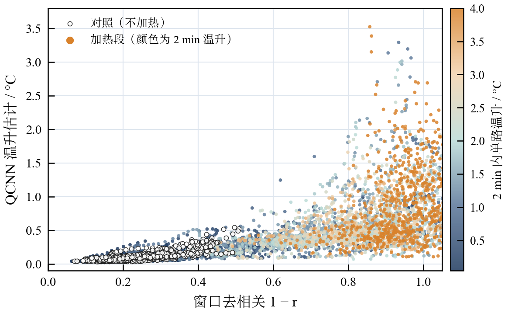

### 板上推理

| 实现 | 单帧耗时 | 本设计的加速比 | 单次能耗 |
|---|---|---|---|
| **PL 推理核（本设计）** | **1.33 ms**（含 DMA 调用） | — | **0.29 mJ** |
| 同一 QCNN 在 A53 上（定点） | 33.5 ms | 25 倍 | — |
| 现成网络在 A53 上 | 96～2668 ms | 70～2000 倍 | — |
| 台式机 GPU 运行 MNet-reg | — | — | 48 mJ |

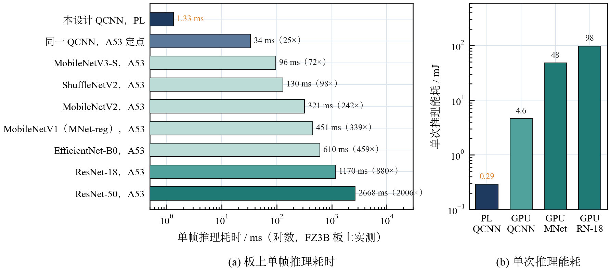

### 推理核优化（XC7Z020，同一模型）

| 实现 | 单帧耗时 | DSP | BRAM_18K | 能否布局 |
|---|---|---|---|---|
| 串行实现（优化前） | 18.06 ms | 7 | — | 能 |
| **并行 + 层间流水（本设计）** | **0.565 ms** | 104 / 220 | **60 / 280** | **能** |
| hls4ml，复用因子 576 | 5.36 ms | 106 / 220 | 603 / 280 | 超出容量 |
| hls4ml，复用因子 64 | 2.70 ms | 915 / 220 | 1080 / 280 | 超出容量 |

比串行实现快 32 倍；hls4ml 生成的实现 BRAM 需求是器件容量的 2～4 倍，无法布局。

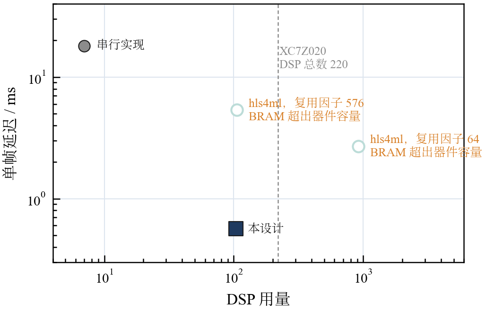

### 硬件指标（FZ3B 合并比特流）

| 指标 | 数值 | 来源 |
|---|---|---|
| 推理核吞吐 | 565 µs/帧，100 MHz | `sim/results/tb_qcnn_core.log` |
| 与定点模型一致性 | 仿真 144/144，板上 40/40 逐位一致 | 同上；板上实测 |
| 时序 | WNS +2.545 ns，WHS +0.005 ns | `build/vivado/reports/` |
| 资源 | LUT 28.8%，FF 14.2%，BRAM 24.8%，DSP 30.0% | 同上 |
| 片上功耗 | 2.99 W（Vivado 估计） | 同上 |
| 相机采集 | 640×800 @149.8 fps；320×400 @299.0 fps | 板上实测 |
| 显示 | 800×480 @60 Hz，Mini DP | 板上实测 |

### 实验台与数据集

自建 9 路独立加热的测温台，共录制 37 段数据、约 9.5 万帧。第三次采集锁定曝光、每秒 5 帧取中位数，并加入 4 段纯对照和 5 段长平台；报警方法的训练与评估使用其中 11 段、3.4 万帧。

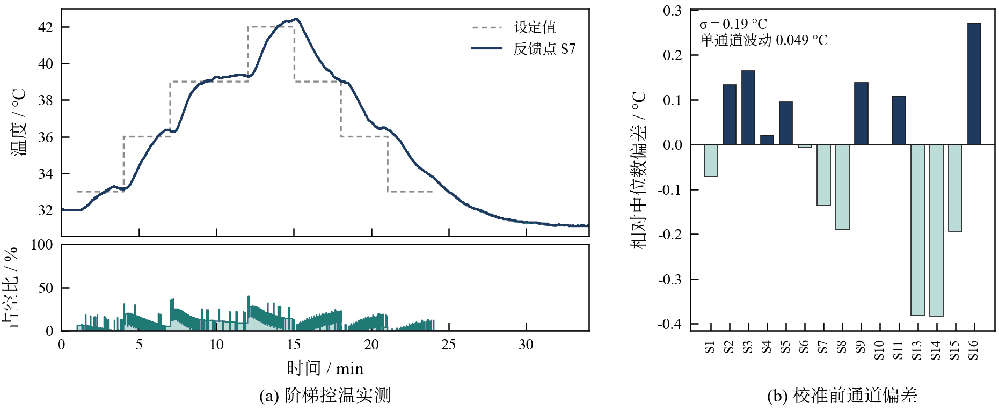

(a) 一轮阶梯控温，34 min 内覆盖 31.1～42.4 °C；(b) 加热全关静置 33 min，单通道读数波动平均 0.049 °C。

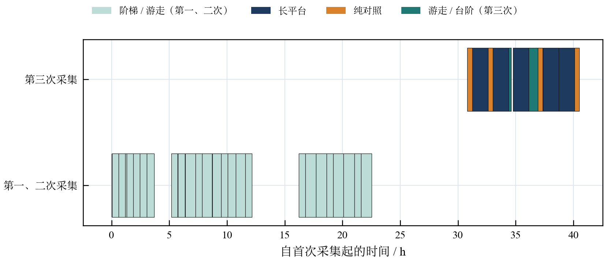

### 终端界面

7 英寸触摸屏，PS 端渲染。散斑页可切换原始、伪彩与局部去相关视图：

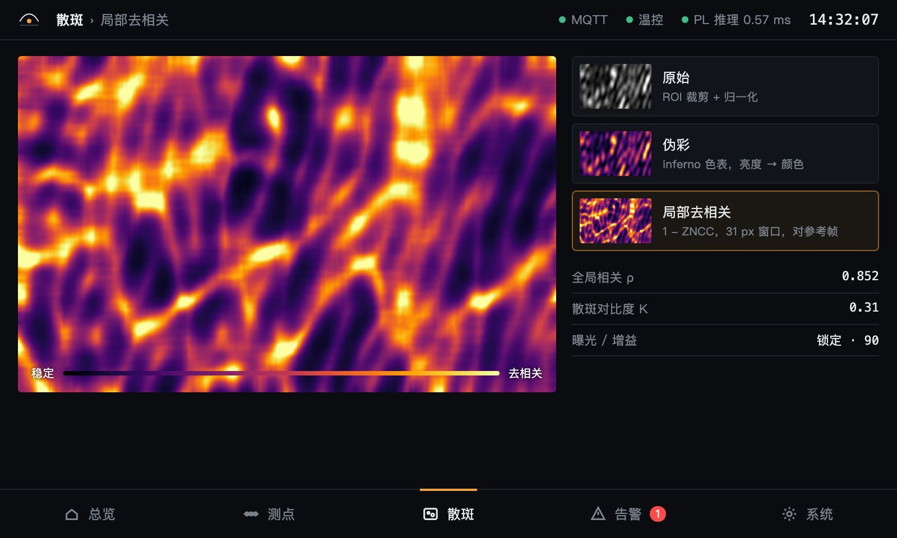

## 复现

```bash
conda env create -f environment.yml && conda activate speckle
./build/fetch_rtl_deps.sh                                   # 开源 RTL（verilog-axis，固定提交）

./sim/rtl/run_verilator.sh tb_qcnn_core                     # 推理核：144/144 逐位一致
./sim/rtl/run_verilator.sh tb_axis_frame_link               # DMA 帧链路：72/72
python -I sim/host/test_node.py                             # 板端软件：ALL PASS
./skill/tests/run_tests.sh                                  # 技能包脚本：ALL PASS

FSF_CAM=1 FSF_VIDEO=1 vivado -mode batch -source build/vivado/build_fz3b.tcl   # 构建比特流
```

上板步骤见 `board/fz3b/README.md`；仓库已带一份构建结果 `board/fz3b/prebuilt/`（带 sha256）。

## 目录

按 AMD 选题指南 3.3.5.4 推荐结构。

| 目录 | 内容 |
|---|---|
| `src/` | RTL（相机采集、QCNN 推理核、DMA 链路、屏幕合成）、PS 侧 Python、训练与定点模型 |
| `sim/` | testbench、板端软件测试与结果日志 |
| `build/` | 构建脚本与综合实现报告 |
| `board/` | 上板说明、预编译比特流、实测输出 |
| `data/` | 训练好的模型、报警参数、测试数据 |
| `skill/` | 技能包：踩坑清单、通用校验脚本、提示词模板 |
| `report/` | 设计报告、系统架构说明与架构图、大模型协作记录 |
| `tools/` | 界面素材生成、上位机监视页 |

系统架构说明见 [`report/architecture.md`](report/architecture.md)。各目录下有 `README.md`。
