# fiber_speckle_thermo

[中文](README.md) | English

An FPGA edge terminal that raises real-time alarms on temperature rises along a multimode optical fiber.

A multimode fiber is wound along a liquid-cooling pipe. A camera captures the speckle pattern at the fiber output, and an EdgeBoard FZ3B performs capture, QCNN inference, alarm decision, on-screen display and MQTT reporting on the board.

| Item | Value |
|---|---|
| Track | 2026 National Undergraduate Embedded Chip and System Design Competition · FPGA track · AMD open topic (junior group) |
| Board | EdgeBoard FZ3B, Zynq UltraScale+ ZU3EG (`xczu3eg-sfvc784-1-i`) |
| Camera | OV9281, MIPI CSI-2 1-lane, RAW8 640×800 |
| Tools | Vivado 2026.1; on board: Linux 4.14, Python 3.6.9, numpy 1.13.3 |
| License | MIT |

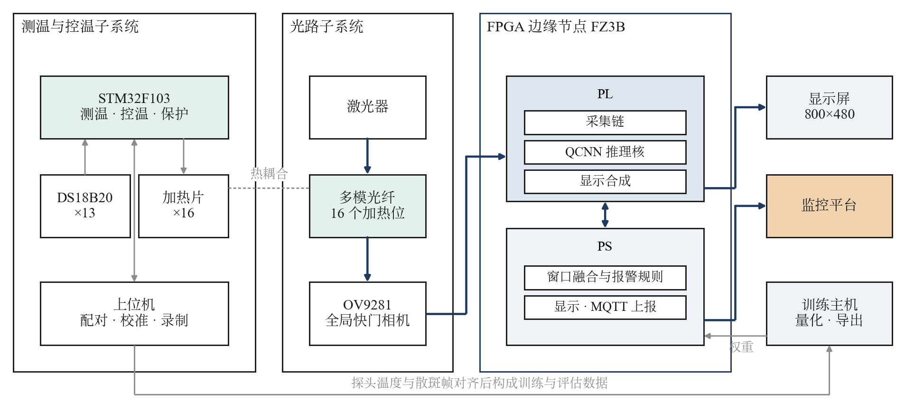

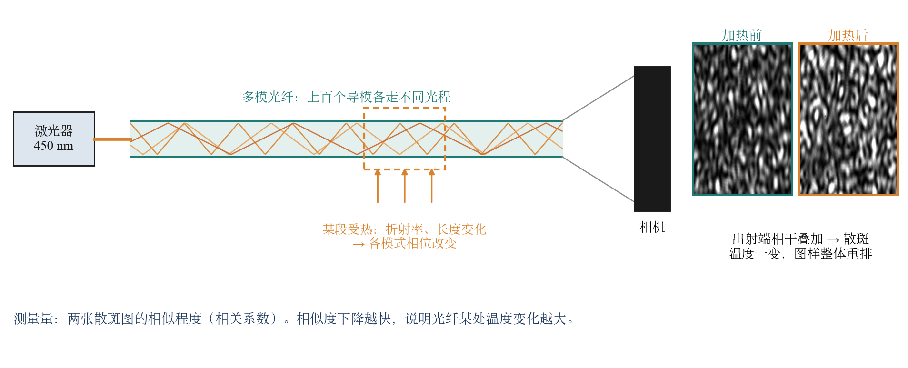

When a section of the fiber heats up, its refractive index and length change, so the optical path of every mode changes and the speckle pattern rearranges. Comparing how similar two speckle images are tells whether any part of the fiber is warming up.

Labels inside the figures are in Chinese; each figure is explained in the text below it.

## Results

### The difficulty: the speckle drifts even without heating

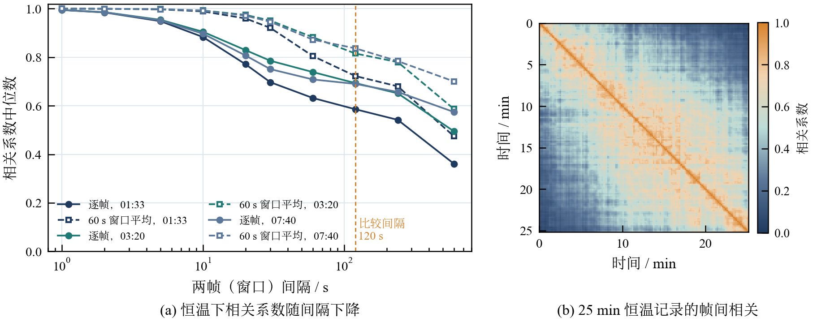

With all heaters off, two frames 60 s apart already have a correlation of only 0.6–0.7 while the probe temperatures barely change; this comes from fluctuations in the laser's wavelength and power. After averaging 60 s of frames, the correlation at the same interval recovers clearly. The alarm method is built on this observation, and its threshold is calibrated with no-heat control data.

### Alarm performance against other methods (same protocol)

11 recorded sessions from the third collection, 5-fold hold-out; thresholds are set from the training folds' no-heat control sessions only. Detection rate is measured at 1 % false alarms, on windows where one channel rises by at least 1 °C within 2 min.

| Method | AUC | Detection | Events | Median delay | Compute (MMAC) | Real-time on PL |
|---|---|---|---|---|---|---|
| **This work** (QCNN + window decorrelation) | **0.993** | **92%** | **30/30** | **25 s** | **2.6** | **Yes** |
| ResNet-18, fine-tuned | 0.994 | 95% | 30/30 | 63 s | 712 | No |
| MobileNetV3-S, fine-tuned | 0.992 | 94% | 30/30 | 33 s | 22 | No |
| Window mean-squared difference | 0.986 | 86% | 30/30 | 25 s | — | — |
| Frame-to-frame correlation | 0.816 | 30% | 24/30 | 213 s | — | — |
| ResNet-18 feature distance | 0.817 | 15% | 25/30 | 125 s | 3628 | No |
| ViT-B/16 feature distance | 0.777 | 9% | 14/30 | 205 s | 35126 | No |

Detection is on par with the fine-tuned large models. The alarm delay is 2/5 of ResNet-18's, compute is 1/270 of ResNet-18 and 1/8 of MobileNetV3-S, and only this design runs in real time on the PL.

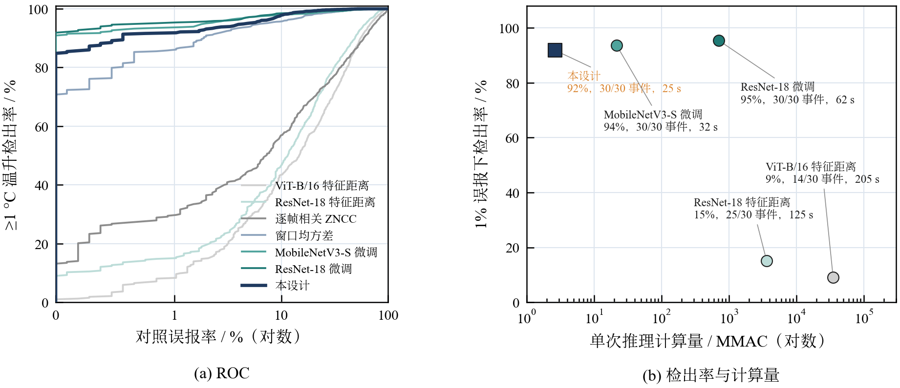

### Alarms during an 80 min plateau session (held-out data)

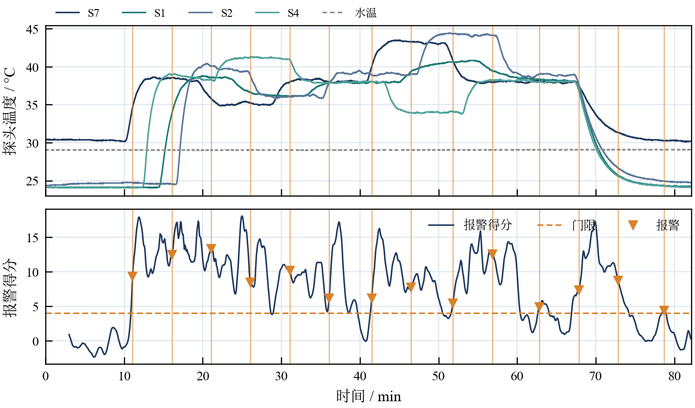

Top: probe temperatures of the heated channels. Bottom: alarm score. After each set-point increase the score crosses the threshold within about half a minute and raises an alarm; once the temperature holds steady, the score falls back below the threshold.

| Detection rate by temperature rise | Alarm delay |
|---|---|
| 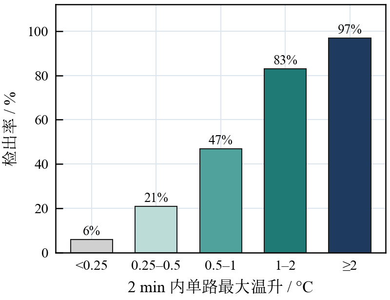 | 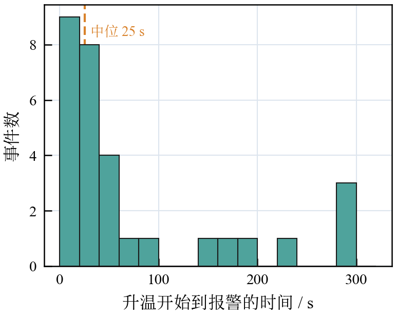 |

Distribution of the two scores: the x-axis is window decorrelation 1 − r, the y-axis is the QCNN temperature-rise estimate. Hollow dots are no-heat controls; colored dots are heated segments, colored by the largest single-channel rise within 2 min. Controls cluster in the lower left, and larger rises move toward the upper right.

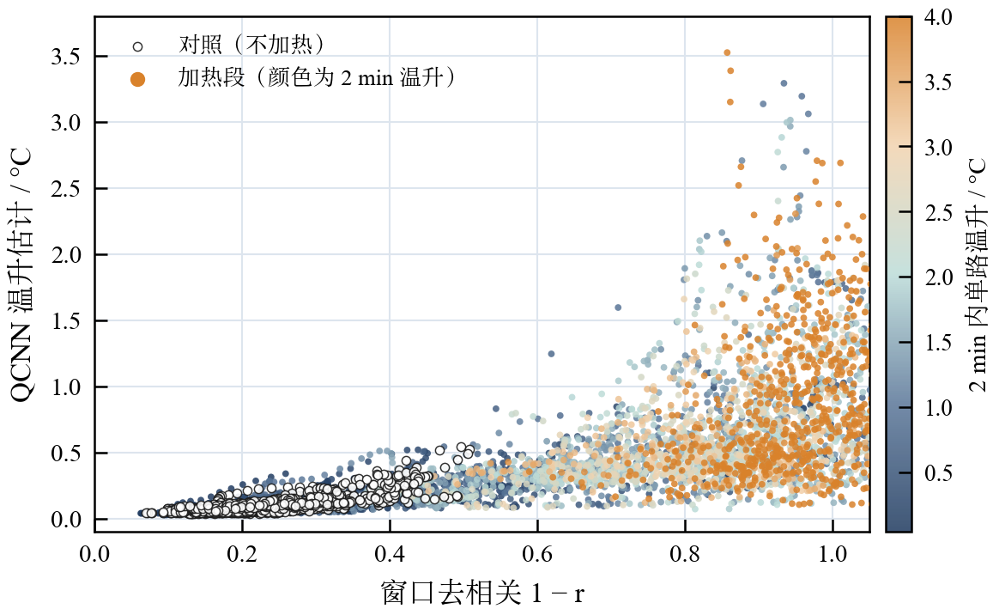

### On-board inference

| Implementation | Per frame | Speed-up of this work | Energy per inference |
|---|---|---|---|
| **PL inference core (this work)** | **1.33 ms** (including the DMA call) | — | **0.29 mJ** |
| Same QCNN on the A53, fixed-point | 33.5 ms | 25× | — |
| Off-the-shelf networks on the A53 | 96–2668 ms | 70–2000× | — |
| Desktop GPU running MNet-reg | — | — | 48 mJ |

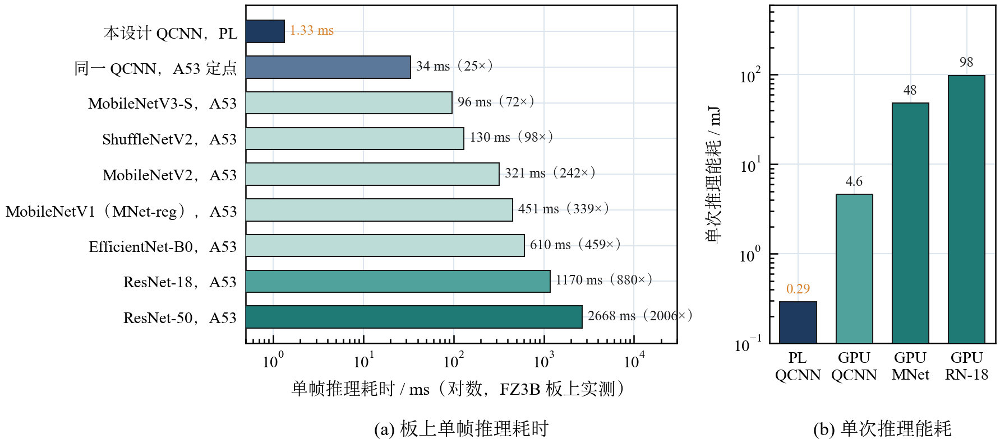

### Inference-core optimization (XC7Z020, same model)

| Implementation | Per frame | DSP | BRAM_18K | Fits the device |
|---|---|---|---|---|
| Serial (before optimization) | 18.06 ms | 7 | — | Yes |
| **Parallel + inter-layer pipeline (this work)** | **0.565 ms** | 104 / 220 | **60 / 280** | **Yes** |
| hls4ml, reuse factor 576 | 5.36 ms | 106 / 220 | 603 / 280 | No |
| hls4ml, reuse factor 64 | 2.70 ms | 915 / 220 | 1080 / 280 | No |

32× faster than the serial version. The hls4ml implementations need 2–4× the device's BRAM and cannot be placed.

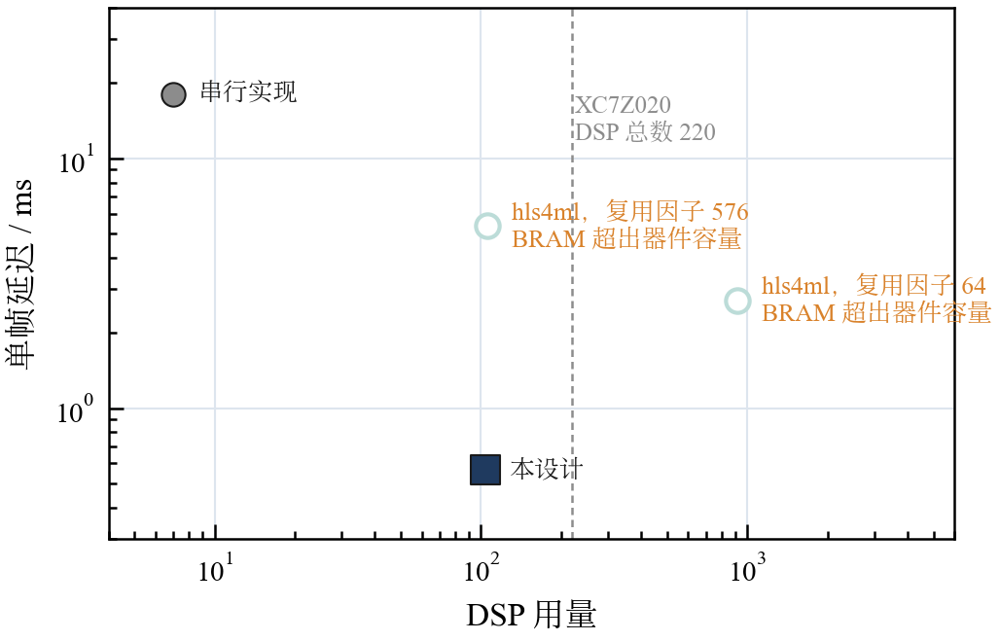

### Hardware metrics (FZ3B combined bitstream)

| Metric | Value | Source |
|---|---|---|
| Core throughput | 565 µs/frame at 100 MHz | `sim/results/tb_qcnn_core.log` |
| Match with the fixed-point model | bit-exact: 144/144 in simulation, 40/40 on the board | same; board measurement |
| Timing | WNS +2.545 ns, WHS +0.005 ns | `build/vivado/reports/` |
| Resources | LUT 28.8%, FF 14.2%, BRAM 24.8%, DSP 30.0% | same |
| On-chip power | 2.99 W (Vivado estimate) | same |
| Camera capture | 640×800 at 149.8 fps; 320×400 at 299.0 fps | board measurement |
| Display | 800×480 at 60 Hz, Mini DP | board measurement |

### Test bench and dataset

A self-built test bench with 9 independently heated sections. 37 sessions, about 95,000 frames in total. The third collection locks the camera exposure, takes the median of 5 frames per second, and adds 4 pure control sessions and 5 long-plateau sessions; the alarm method is trained and evaluated on 11 of its sessions (34,000 frames).

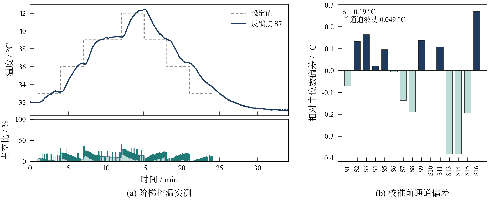

(a) One stepped temperature run covering 31.1–42.4 °C in 34 min; (b) 33 min with all heaters off: average single-channel reading fluctuation 0.049 °C.

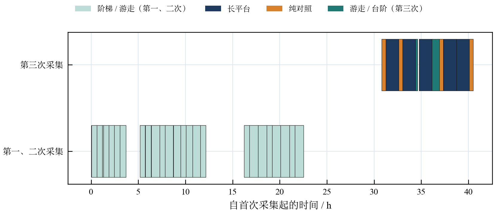

### Terminal UI

7-inch touch screen rendered by the PS. The speckle page switches between raw, false-color and local-decorrelation views:

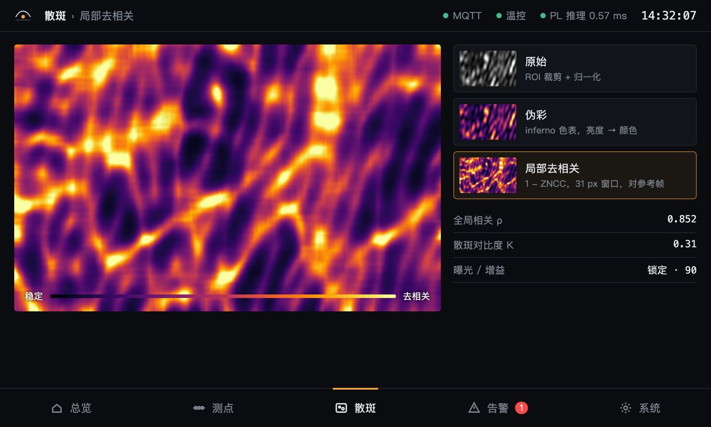

## Reproduce

```bash
conda env create -f environment.yml && conda activate speckle
./build/fetch_rtl_deps.sh                                   # open-source RTL (verilog-axis, pinned commit)

./sim/rtl/run_verilator.sh tb_qcnn_core                     # inference core: 144/144 bit-exact
./sim/rtl/run_verilator.sh tb_axis_frame_link               # DMA frame link: 72/72
python -I sim/host/test_node.py                             # board software: ALL PASS
./skill/tests/run_tests.sh                                  # skill scripts: ALL PASS

FSF_CAM=1 FSF_VIDEO=1 vivado -mode batch -source build/vivado/build_fz3b.tcl   # build the bitstream
```

Board bring-up is described in `board/fz3b/README.md` (Chinese). A prebuilt bitstream with sha256 sums is in `board/fz3b/prebuilt/`.

## Layout

Follows the layout recommended in §3.3.5.4 of the AMD topic guide.

| Directory | Content |
|---|---|
| `src/` | RTL (camera capture, QCNN inference core, DMA link, screen compositor), PS-side Python, training and fixed-point model |
| `sim/` | testbenches, board-software tests and result logs |
| `build/` | build scripts and synthesis/implementation reports |
| `board/` | bring-up notes, prebuilt bitstream, board measurements |
| `data/` | trained model, alarm parameters, test data |
| `skill/` | skills: pitfall checklists, generic check scripts, prompt templates ([English](skill/README_en.md)) |
| `report/` | design report, architecture ([English](report/architecture_en.md)), LLM collaboration log ([English](report/llm_log/README_en.md)) |
| `tools/` | UI asset generation, host monitoring page |

The design report and the per-directory `README.md` files are in Chinese.
