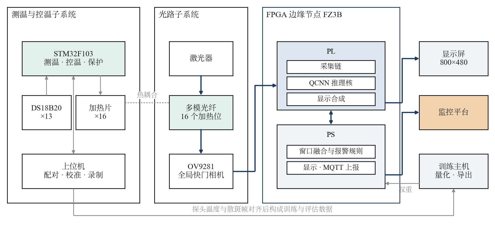
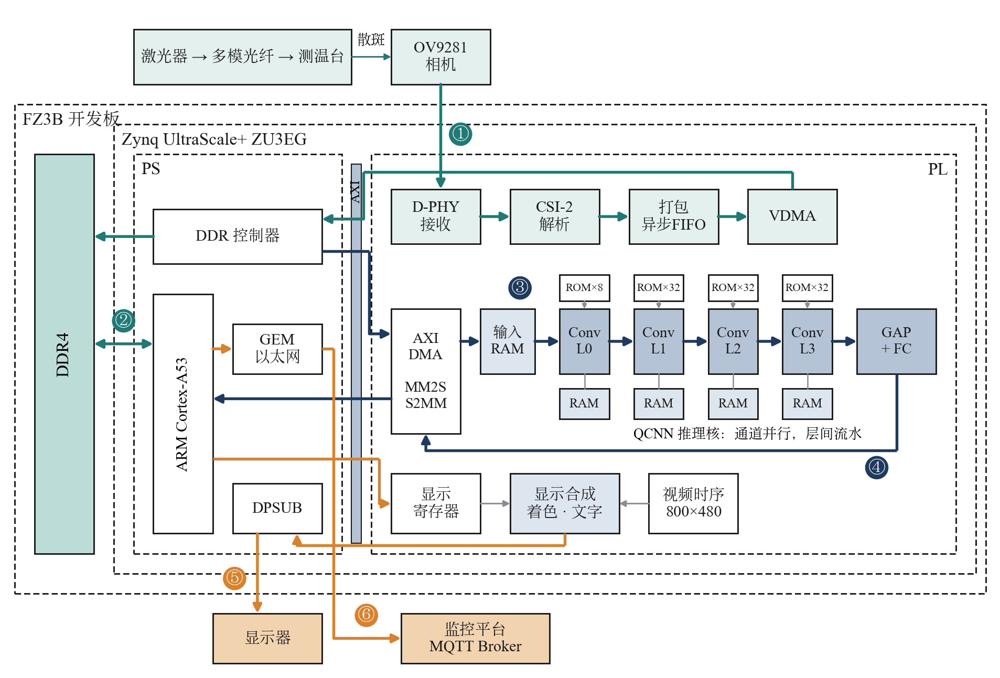
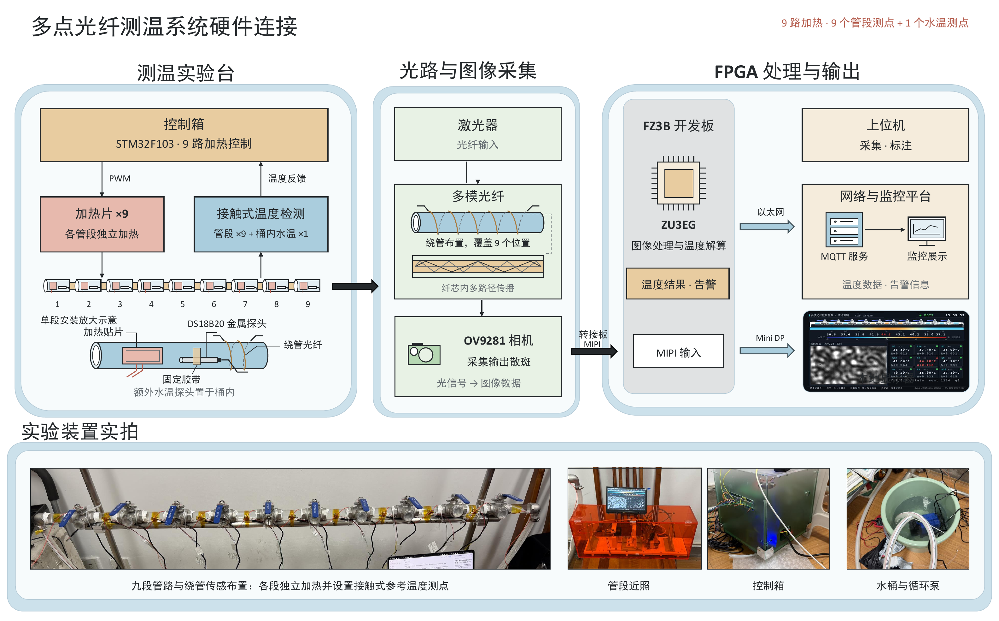
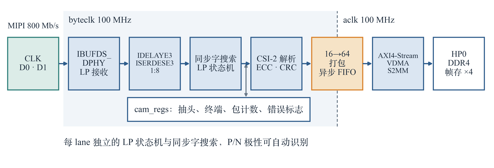
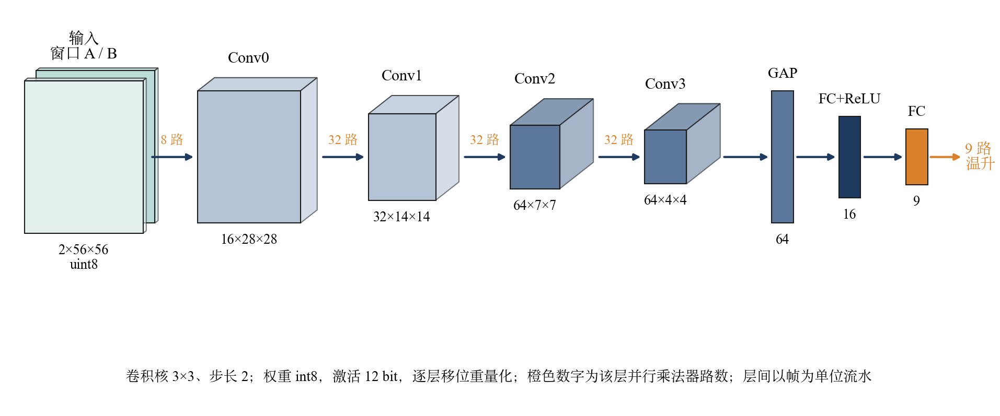
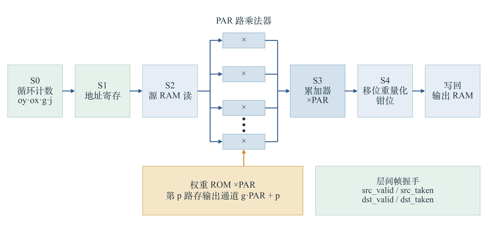
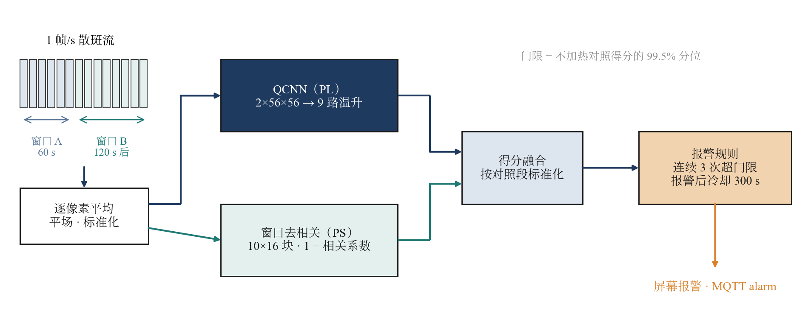
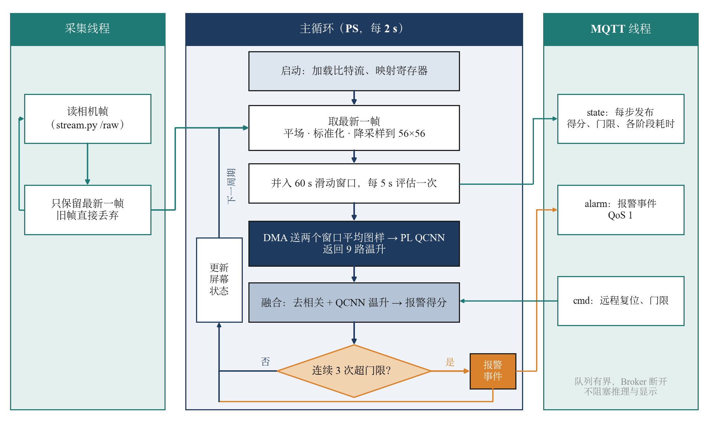

# 系统架构 System architecture

图片在 `report/figures/`，与设计报告（`report/design_report.pdf`）第二部分的图一致。

## 1. 系统组成 System overview

一根多模光纤绕在液冷管路上，光纤出射的散斑图样由 OV9281 相机采集，送入 EdgeBoard FZ3B（Zynq UltraScale+ ZU3EG）。
板上完成采集、预处理、QCNN 推理、窗口融合报警、屏幕显示和 MQTT 上报，上位机只负责接收和展示。

## 2. 软硬件划分与数据流 HW/SW partition and data flow

| 位置 | 模块 | 代码 | 划分依据 |
|---|---|---|---|
| PL | D-PHY 接收、CSI-2 解析、VDMA 写帧存 | `src/rtl/cam/` | 800 Mb/s 串行数据，只能在 PL 解串 |
| PS | 取帧、平场 + 标准化、56×56 下采样 | `src/host/speckle_preproc.py` | 逐帧统计量和查表，数据量小、逻辑多变，留在 PS 便于和训练侧逐位一致 |
| PL | QCNN 推理核（参考窗口 + 当前窗口 → 9 路 ΔT） | `src/rtl/qcnn/`、`src/rtl/link/` | 卷积乘加占计算量的绝大部分，PL 565 µs/帧 |
| PS | 60 s 窗口平均、1 − 相关系数、融合打分、连续 3 次报警 | `src/host/win_fusion.py`、`src/host/speckle_node.py` | 每 5 s 一次的标量运算 |
| PS | 屏幕界面、MQTT | `src/host/fsf_ps_ui.py`、`src/host/mqtt_lite.py` | 与推理解耦，慢或断开不阻塞主循环 |

PS 与推理核之间用 AXI DMA（PG021 simple mode）传输，驱动在 `src/host/qcnn_dma.py`，不依赖 PYNQ。地址分配见 `board/fz3b/prebuilt/address_map.txt`。

## 3. 硬件连接 Hardware setup

测温实验台的 9 路加热和接触式测温只用于产生升温和提供参考温度，不参与板上推理。

## 4. 相机采集链 Camera capture chain (PL)

## 5. QCNN 推理核 Inference core (PL)

4 层 3×3 stride-2 卷积 + GAP + 2 层 FC，权重 int8、激活 12 bit，缩放全为 2 的幂。层内按输出通道并行，层间按帧流水。

## 6. 报警方法 Alarm method

QCNN 温升估计与两窗口块相关的 1 − 相关系数，按不加热对照数据标准化后以 1 : 0.1 加权，连续 3 次超过门限报警。
训练与评估见 `src/model/win_alarm/README.md`，参数在 `data/fusion/fusion.json`。

## 7. 节点程序流程 Node software flow (PS)

capture 线程取帧、主循环推理与判定、mqtt 线程上报，三者通过有界队列解耦。说明见 `src/host/README.md`。
