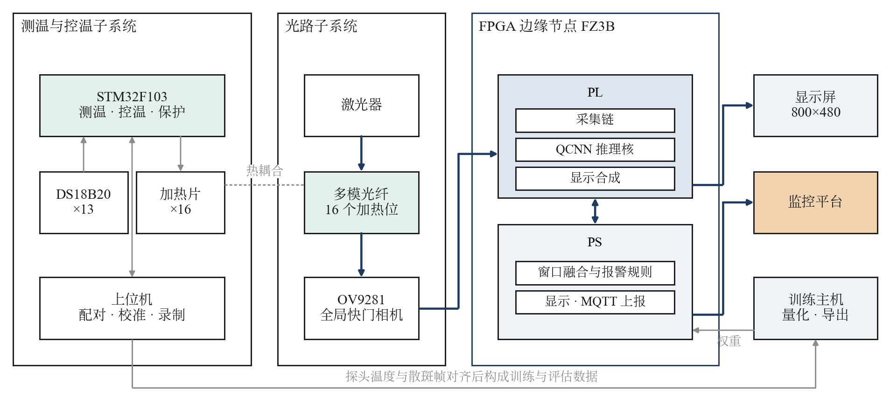
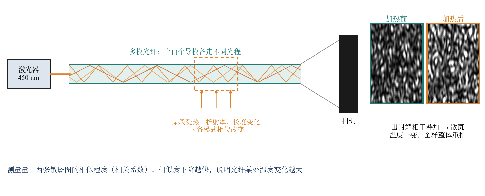
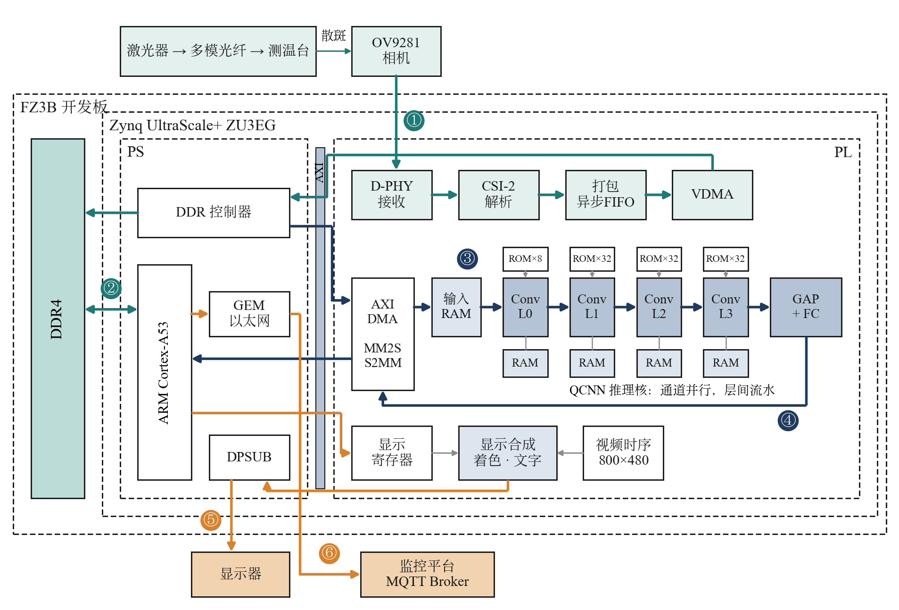
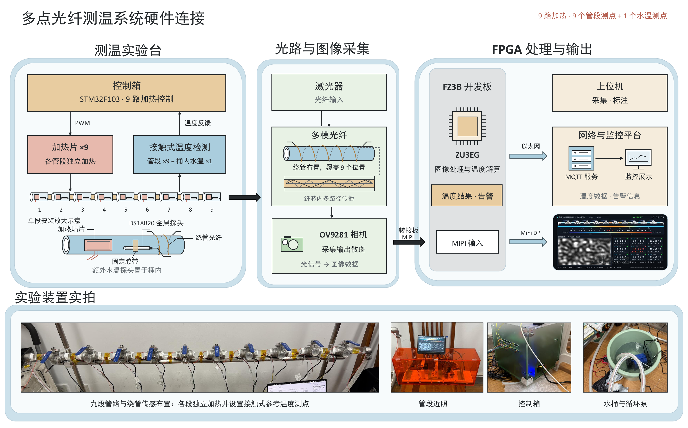
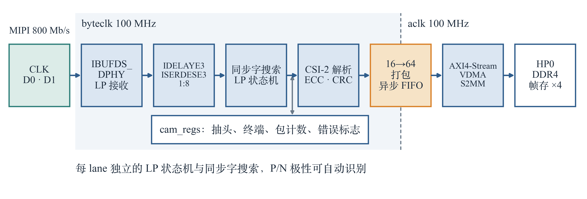
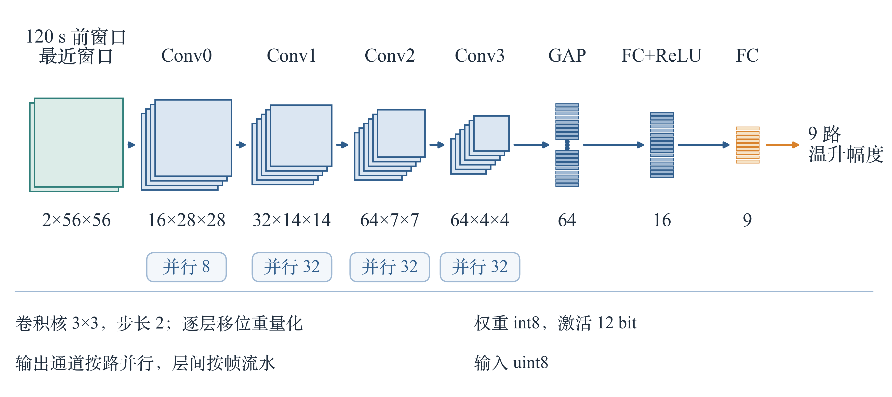
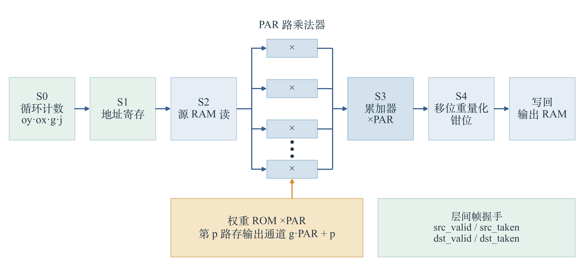
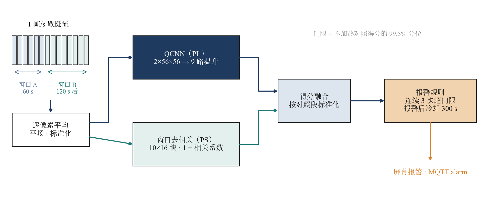
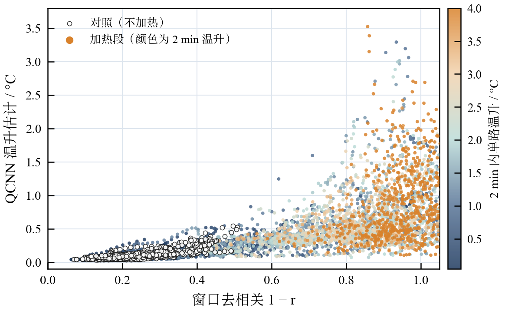
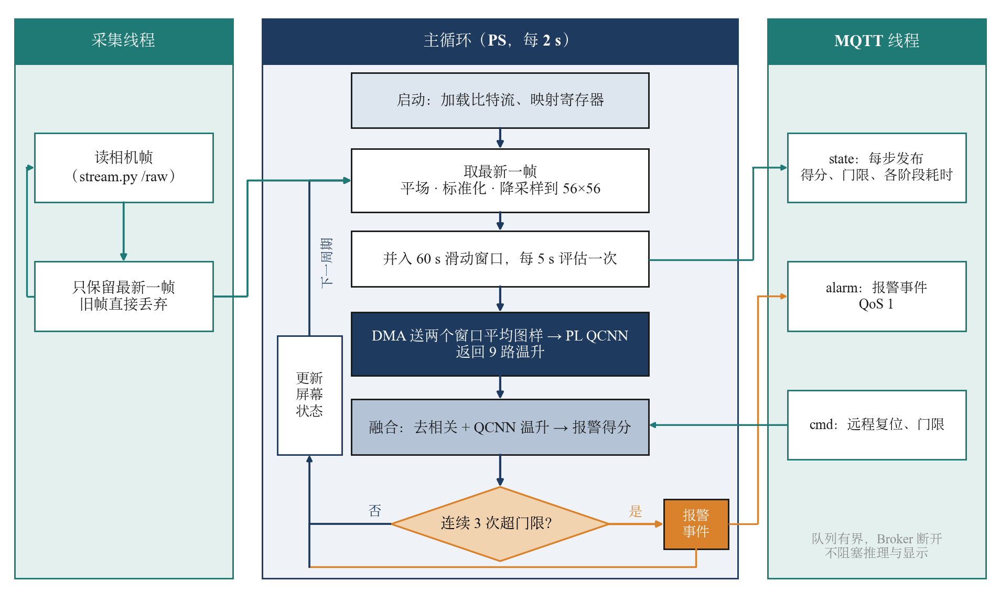

# System architecture

[中文](architecture.md) | English

Figures are in `report/figures/` and match those in the design report (`report/design_report.pdf`). Labels inside the figures are in Chinese.

## 1. System overview

A multimode fiber is wound along a liquid-cooling pipe. An OV9281 camera captures the speckle pattern at the fiber output and feeds it to an EdgeBoard FZ3B (Zynq UltraScale+ ZU3EG).
The board performs capture, preprocessing, QCNN inference, windowed-fusion alarm, on-screen display and MQTT reporting; the host only receives and displays.

## 2. HW/SW partition and data flow

| Where | Block | Code | Reason |
|---|---|---|---|
| PL | D-PHY receiver, CSI-2 parser, VDMA to frame buffers | `src/rtl/cam/` | 800 Mb/s serial data can only be deserialized in the PL |
| PS | frame fetch, flat-field + normalization, 56×56 downsampling | `src/host/speckle_preproc.py` | per-frame statistics and lookups; little data, many branches; staying on the PS keeps it bit-exact with training |
| PL | QCNN inference core (reference window + current window → 9 ΔT outputs) | `src/rtl/qcnn/`, `src/rtl/link/` | convolution multiply-accumulates are almost all of the compute; 565 µs per frame on the PL |
| PS | 60 s window averaging, 1 − correlation, fused score, alarm after 3 consecutive hits | `src/host/win_fusion.py`, `src/host/speckle_node.py` | scalar work once every 5 s |
| PS | screen UI, MQTT | `src/host/fsf_ps_ui.py`, `src/host/mqtt_lite.py` | decoupled from inference; a slow or lost broker never blocks the main loop |

The PS and the inference core exchange data over AXI DMA (PG021 simple mode). The driver is `src/host/qcnn_dma.py` and does not need PYNQ. Address map: `board/fz3b/prebuilt/address_map.txt`.

## 3. Hardware setup

The 9 heaters and contact temperature probes of the test bench only create temperature rises and provide reference readings; they take no part in on-board inference.

## 4. Camera capture chain (PL)

## 5. QCNN inference core (PL)

4 convolution layers (3×3, stride 2) + global average pooling + 2 FC layers; int8 weights, 12-bit activations, all scales powers of two. Output channels run in parallel inside a layer; layers are pipelined across frames.

## 6. Alarm method

The QCNN temperature-rise estimate and the block-wise 1 − correlation between two windows are normalized with no-heat control data and combined with weights 1 : 0.1; an alarm is raised after 3 consecutive scores above the threshold.
Training and evaluation: `src/model/win_alarm/README.md`; parameters: `data/fusion/fusion.json`.

## 7. Node software flow (PS)

A capture thread fetches frames, the main loop runs inference and decisions, and an MQTT thread publishes; bounded queues decouple the three. Details: `src/host/README.md`.
